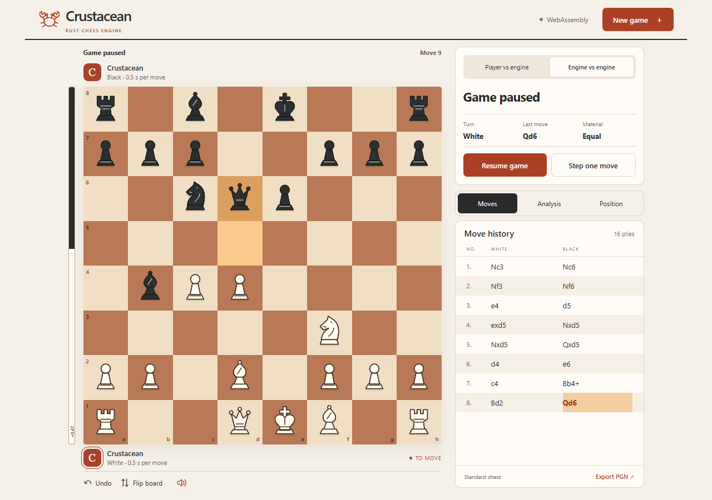

# Crustacean

[](https://github.com/jasonshaw0/crustacean/actions/workflows/pages.yml)
[](Cargo.toml)

A dependency-free Rust chess engine with UCI, terminal play, and a WebAssembly demo.
Independent implementation, not a Stockfish port.

Iterative-deepening alpha-beta search with quiescence, killer and history move ordering,
and tapered material/positional evaluation. Supports time, depth, and node limits,
cancellation, and standard chess rules, including repetition and fifty-move draws.
Chess960 and pondering are not supported.

[Browser demo](https://jasonshaw0.github.io/crustacean/) — the same Rust engine, compiled to WebAssembly.

[](docs/images/crustacean-ui.png)

## Run

```sh
cargo run --release -- uci
cargo run --release -- play
cargo run --release -- gui
cargo run --release -- analyze --movetime 1000
cargo run --release -- perft 4
```

## Build demo and test

```sh
rustup target add wasm32-unknown-unknown
node scripts/build-web.mjs
cargo test --release --locked
node --test tests/*.mjs
```

Serve `dist/` over HTTP.
